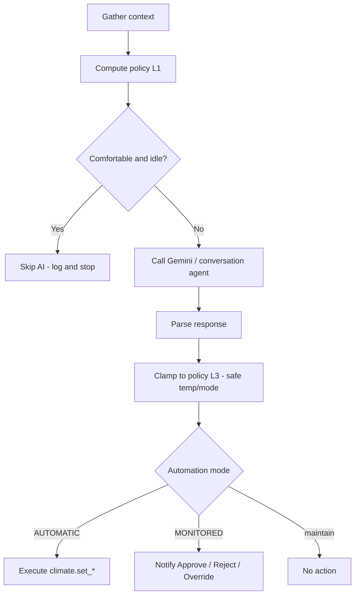

# AI HVAC Controller

AI-powered Home Assistant HVAC optimization using Gemini (or any `conversation` agent), per-zone policy profiles, template-enforced safety, and optional MONITORED mode with notification overrides.

**Repository:** [github.com/blord1976/AI-HVAC-Controller](https://github.com/blord1976/AI-HVAC-Controller)

---

## Features

- **AI advisor** — Hourly analysis of indoor/outdoor conditions, weather, and occupancy
- **Zone policies** — Separate rule profiles for **Living Room** and **Upstairs** (mode thresholds, nighttime setpoints, ECO behavior)
- **Template safety (L1 + L3)** — Required HVAC mode, setpoint floors/ceilings, max change per run, and skip-if-comfortable run *before/after* the AI (not prompt-only)
- **Thermal comfort** — Optional heat index (“feels-like”) and dew point sensors
- **ECO mode** — Setbacks when home is unoccupied (via your occupancy helper)
- **Three automation modes** — OFF, **AUTOMATIC** (default), MONITORED (approval + override buttons)
- **Multi-zone** — One blueprint; create one automation per thermostat

---

## Repository files

| File | Purpose |
|------|---------|
| [`ai_hvac_blueprint_unified.yaml`](ai_hvac_blueprint_unified.yaml) | Main blueprint — import into Home Assistant |
| [`ai_hvac_override_handler.yaml`](ai_hvac_override_handler.yaml) | Optional: natural-language override from notifications (MONITORED mode) |
| [`ZONE-RULES-IMPLEMENTATION.md`](ZONE-RULES-IMPLEMENTATION.md) | Detailed rule map, entity wiring, future triggers/helpers |
| `README.md` | This guide |

---

## Quick start (per zone, ~10 minutes)

### 1. Import the blueprint

**Settings → Automations & Scenes → Blueprints → Import Blueprint**

```
https://raw.githubusercontent.com/blord1976/AI-HVAC-Controller/main/ai_hvac_blueprint_unified.yaml
```

Or upload `ai_hvac_blueprint_unified.yaml` from this repo.

### 2. Create an automation from the blueprint

**Settings → Automations → Create Automation → AI HVAC Advisor**

Create **one automation per zone** (e.g. Living Room and Upstairs). Each must use a **unique Action ID Prefix** (`LR`, `UPSTAIRS`, etc.).

### 3. Recommended configuration

| Setting | Living Room | Upstairs |
|---------|-------------|----------|
| **Zone policy profile** | Living Room | Upstairs |
| **Thermostat** | `climate.lr_stat` (or your Ezlo entity) | `climate.upstairs_stat` |
| **Home occupancy** | `input_boolean.anyone_home` | `input_boolean.anyone_home` |
| **Zone occupancy** (optional) | — | `binary_sensor.upstairs_occupancy_status` |
| **Feels-like sensor** | `sensor.lr_thermal_comfort_heat_index` | `sensor.upstairs_thermal_comfort_heat_index` |
| **Dew point sensor** | `sensor.lr_thermal_comfort_dew_point` | `sensor.upstairs_thermal_comfort_dew_point` |
| **Automation mode** | **AUTOMATIC** (recommended) | **AUTOMATIC** |
| **ECO mode** | Enabled (adjust offsets as desired) | Enabled |

Replace entity IDs with yours if different. See [ZONE-RULES-IMPLEMENTATION.md](ZONE-RULES-IMPLEMENTATION.md) for the full wiring table and rule breakdown.

### 4. Ezlo / Z-Wave thermostats

- Supported modes are typically: `off`, `heat`, `cool`, `heat_cool`
- **“Auto” in zone rules** = Home Assistant mode **`heat_cool`**
- When occupied, the policy uses **heat or cool only** (not `heat_cool`)
- When away (ECO), **`heat_cool`** is allowed for basic protection

### 5. Test

1. Enable the automation and wait for the next hourly run, or run it manually.
2. **Settings → System → Logs** — search `AI HVAC`
3. **Logbook** — filter by zone name
4. In AUTOMATIC mode, changes execute immediately with a passive notification

---

## Zone policy summary

Policies are enforced in **templates** and summarized again in the **AI prompt**. Full detail: [ZONE-RULES-IMPLEMENTATION.md](ZONE-RULES-IMPLEMENTATION.md).

### Living Room

| Topic | Rule |
|-------|------|
| **Occupied mode** | Heat or cool only (never auto/`heat_cool`) |
| **Summer** | Outdoor > 75°F → cool |
| **Winter** | Outdoor < 55°F → heat |
| **Forecast** | High > 70°F → cool; high < 60°F → heat |
| **Night (11pm+)** | Setpoint **never below 74°F** |
| **Away (ECO)** | `heat_cool` + setbacks |
| **Comfort** | Prefer heat index; target feels-like ~68–72°F |

### Upstairs

| Topic | Rule |
|-------|------|
| **Occupied mode** | Heat or cool only |
| **Summer** | Outdoor > 65°F → cool |
| **Winter** | Outdoor < 50°F → heat |
| **Forecast** | High > 65°F → cool; high < 50°F → heat; prefer cool when uncertain |
| **Night (10pm+)** | Setpoint **never above 71°F** |
| **Daytime unoccupied** | Generally 72–74°F; weekend/zone sensors can imply occupancy |
| **Away (ECO)** | `heat_cool` + setbacks |
| **Comfort** | Heat index; daytime feels ~68–74°F; night ~65–70°F |

---

## How it works

Every hour (when mode is not OFF):



| Layer | What it does |
|-------|----------------|
| **L1 – Policy templates** | Required mode, ECO, night min/max, skip-if-comfortable |
| **L2 – AI prompt** | Judgment inside L1 bounds (shoulder season, nuance) |
| **L3 – Safe clamp** | Enforces bounds on AI output before any thermostat command |

---

## Automation modes

| Mode | Behavior |
|------|----------|
| **OFF** | No runs |
| **AUTOMATIC** | AI suggestion is clamped by policy, then executed; passive notification |
| **MONITORED** | Notification with Approve / Reject / Override; requires extra setup (see below) |

Default blueprint mode: **AUTOMATIC**.

---

## Safety limits (blueprint inputs)

- **Min / max temperature** — Absolute bounds (defaults 60–85°F)
- **Max temperature change** — Per-run delta from current target (default 4°F)
- **Zone policy** — Applies night rules on top (LR floor 74°F, Upstairs cap 71°F)
- **Doors open** — AI instructed to recommend `turn_off` (wire a door sensor if used)

---

## ECO mode

When **home occupancy** is off/unoccupied (`input_boolean.anyone_home` off, or your configured entity):

- ECO is active if enabled in blueprint
- Cooling target can rise by **ECO cooling offset**; heating target can drop by **heating offset**
- HVAC mode may switch to **`heat_cool`** for away protection

When anyone is home, ECO is inactive and comfort rules apply.

---

## Monitoring

**Logs:** Settings → System → Logs → search `AI HVAC`

**Logbook:** Filter by zone name or `AI HVAC`

**Skip runs:** Log message `Skip AI — feels-like … in band` means L1 decided no AI call was needed.

**Clamped runs:** Log may include `| clamped` when L3 adjusted AI output.

---

## Optional: MONITORED mode + overrides

Use this if you want **approval** or **natural-language overrides** from phone notifications instead of fully automatic execution.

### Requirements

1. Set blueprint **Automation mode** to **MONITORED**
2. Install [`ai_hvac_override_handler.yaml`](ai_hvac_override_handler.yaml) as a separate automation (once per HA instance)
3. Create per-zone helpers (example Living Room):

| Helper | Entity ID | Max length |
|--------|-----------|------------|
| Learning log | `input_text.ai_hvac_lr_learning_log` | 5000 |
| Pending thermostat | `input_text.ai_hvac_lr_pending_thermostat` | 100 |

Repeat for each zone prefix (`upstairs`, etc.).

4. **Approve / Reject handlers** — The blueprint fires `ai_hvac_suggestion_pending` events and shows Approve/Reject buttons, but **you still need automations** that listen for `APPROVE_*_HVAC` / `REJECT_*_HVAC` notification actions and apply the change. Override-only setup is documented in the handler file.

5. Customize hardcoded services in the override handler if needed (`agent_id`, `notify.mobile_app_*`).

### Override command examples

- `set to 72` / `78 degrees`
- `switch to heat mode` (use `heat_cool` for Ezlo “auto”)
- `turn off the HVAC`

**Note:** Learning log append is Phase 1 storage; the main blueprint does not yet inject learning history into the hourly AI prompt.

---

## Troubleshooting

### No suggestions / no changes

- Automation enabled and mode not OFF
- Test conversation agent under **Settings → Voice assistants**
- Sensors not `unknown` / `unavailable`
- Check logs for `Skip AI` (comfort band — expected)

### AI suggestion ignored or wrong temp

- Check log for `clamped` — L3 may have limited the setpoint
- Verify **zone policy profile** matches the zone (Living Room vs Upstairs)
- Confirm **feels-like** and **outdoor** entities are wired

### ECO not activating

- `input_boolean.anyone_home` (or your occupancy entity) must go **off** when away
- ECO enabled in blueprint
- Look for ECO in logbook / notifications

### MONITORED: buttons do nothing

- Approve/Reject need separate notification-action automations (not included in minimal repo)
- Override requires helpers + override handler + thermostat stored in pending helper

### After updating the blueprint

1. Re-import blueprint URL or file
2. Open each AI HVAC automation → **Update from blueprint**
3. Re-select new inputs (zone policy, feels-like, dew point, occupancy)
4. Save and test with manual run

---

## Planned enhancements

Documented in [ZONE-RULES-IMPLEMENTATION.md](ZONE-RULES-IMPLEMENTATION.md):

- `input_datetime` helpers for **once-per-day mode switching**
- **8am** forecast mode selection
- **Arrive / leave home** triggers on `anyone_home`
- Stronger upstairs **weekday vs weekend** daytime logic

---

## Sample dashboard card

```yaml
type: entities
title: AI HVAC - Living Room
entities:
  - climate.lr_stat
  - sensor.lr_thermal_comfort_heat_index
  - input_boolean.anyone_home
  - automation.ai_hvac_advisor_living_room
```

---

## Contributing

Issues and PRs welcome: [AI-HVAC-Controller Issues](https://github.com/blord1976/AI-HVAC-Controller/issues)

---

## License

MIT License

---

## Author

Brandon Lord — Home Assistant climate automation with AI and enforceable zone policies.
